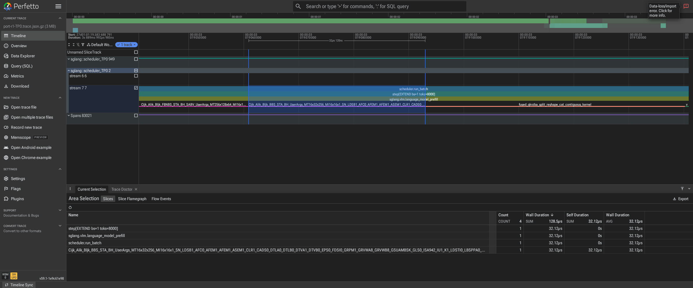
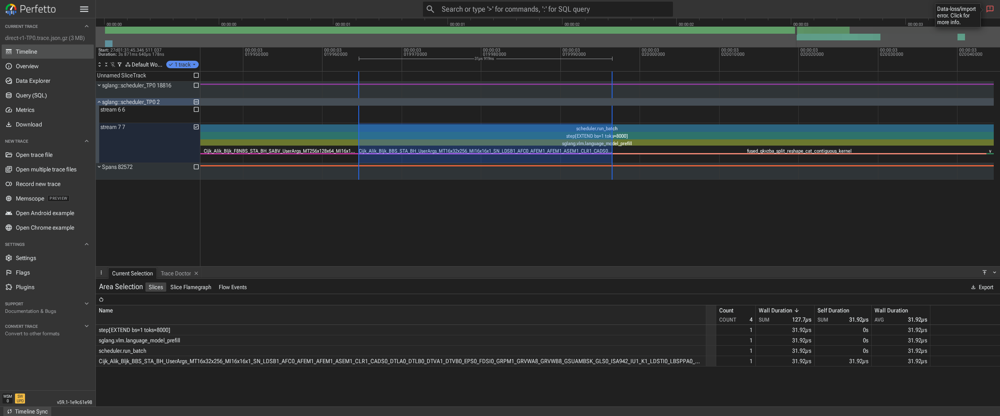
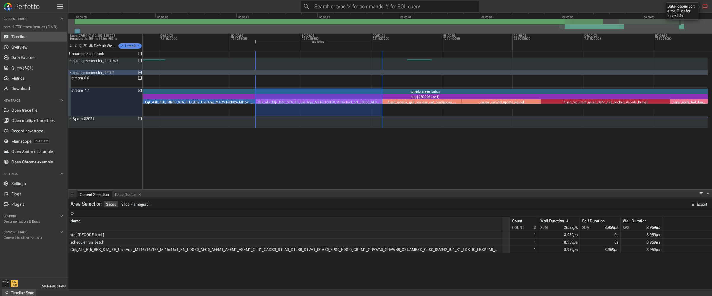

# Original model traces and native Perfetto evidence

This branch contains the complete original TP0 model traces and four native
Perfetto screenshots for the two decode follow-ups, compared with the pure PR8
port. It is an evidence branch; source changes and quality/customer data are not
included.

| Variant | Tested source |
|---|---|
| Before: pure port | `ddccab6e0da380838ef21a87c655624d7f164b1d` |
| After: corrected decode candidate | `176150ccc32f03b663d339b327527c2f85902200` |

The model is Qwen3.5-397B-A17B-PTPC-FP8 on eight AMD Instinct MI308X/gfx942 GPUs,
TP8/PP1, SGLang0.5.21, without speculative decoding. Profiling used two warmups,
8000 input tokens, 500 requested output tokens, greedy sampling with EOS ignored,
and CPU/GPU activities with original tensor shapes. The full trace files retain
all original events, timestamps, PID/TID, ranks, tracks and surrounding operators.

## Native screenshots

Each screenshot opens the complete original `.json.gz` directly in Perfetto and
changes only native UI state: dark theme, track expansion, matched phase scale,
blue Area Selection, Current Selection > Slices, and column width. Prefill uses
100µs on both sides; Decode uses40µs on both sides.

| Phase | Before | After |
|---|---|---|
| Prefill | [Image](figures/prefill-before.png) | [Image](figures/prefill-after.png) |
| Decode | [Image](figures/decode-before.png) | [Image](figures/decode-after.png) |

## Original trace and attribution

- [Complete Before TP0 trace](original-traces/port-r1-TP0.trace.json.gz)
- [Complete After TP0 trace](original-traces/direct-r1-TP0.trace.json.gz)
- [Original-file manifest](manifests/original-trace-manifest.json)
- [Capture manifest](manifests/capture-manifest.json)
- [Source architecture witness](witnesses/projection-source-witness.json)
- [Visual review](manifests/visual-review.md)
- [SHA256SUMS](SHA256SUMS)

The selected BA projection has BF16 K4096/N16, derived from hidden_size4096 and
(64+64)/attentionTP8, with ignored b/a weights packed into `in_proj_ba`.
Prefill actual request batch is1 and matrix M8000; Decode actual request batch
and matrix M are1, with bs1 CUDA graph capture verified. GPU events match exact
original names, times, durations and stream identities. Layer0 is an ordered
sample0/source-order inference under the complete PP1 non-MTP forward, rather
than a directly named profiler layer.

## Evidence limits

The selected GPU samples are Prefill32.120→31.919µs and Decode8.959→5.279µs.
They are single original trace samples; whole-model ETE and statistical conclusions
belong to the separately reported benchmark results. The model samples show
hipBLASLt BBS→swizzled GEMV and have no independent output-copy event, so they do
not demonstrate caller-owned-output API copy removal in the default model path.

Original Perfetto import diagnostics are
`slice_spill_overlapping_complete_event`:36 Before and37 After. Raw traces were
not rewritten to remove the diagnostics; selected GPU events still match exactly.
The native Slices table also contains enclosing step/scheduler scopes, so its
summed Wall Duration includes overlap. Read the GPU kernel row for GPU time and
call count. Local/remote capture paths in hashed witnesses are provenance, not
public filesystem paths; artifact-relative paths are provided by the manifests.

## Supplemental benchmark and validation reports

[Per-start benchmark and validation reports](reports/README.md) document nine complete model starts, eighteen formal cases, actual settings/length/concurrency, source identities, numerical checks and final cleanup. Generated text and full server configuration are excluded; transformations and original source hashes are recorded. Native image and complete model-trace PR links remain pinned to d16bdf05a3d00de8bf5288e5fc185fccff193d94.
