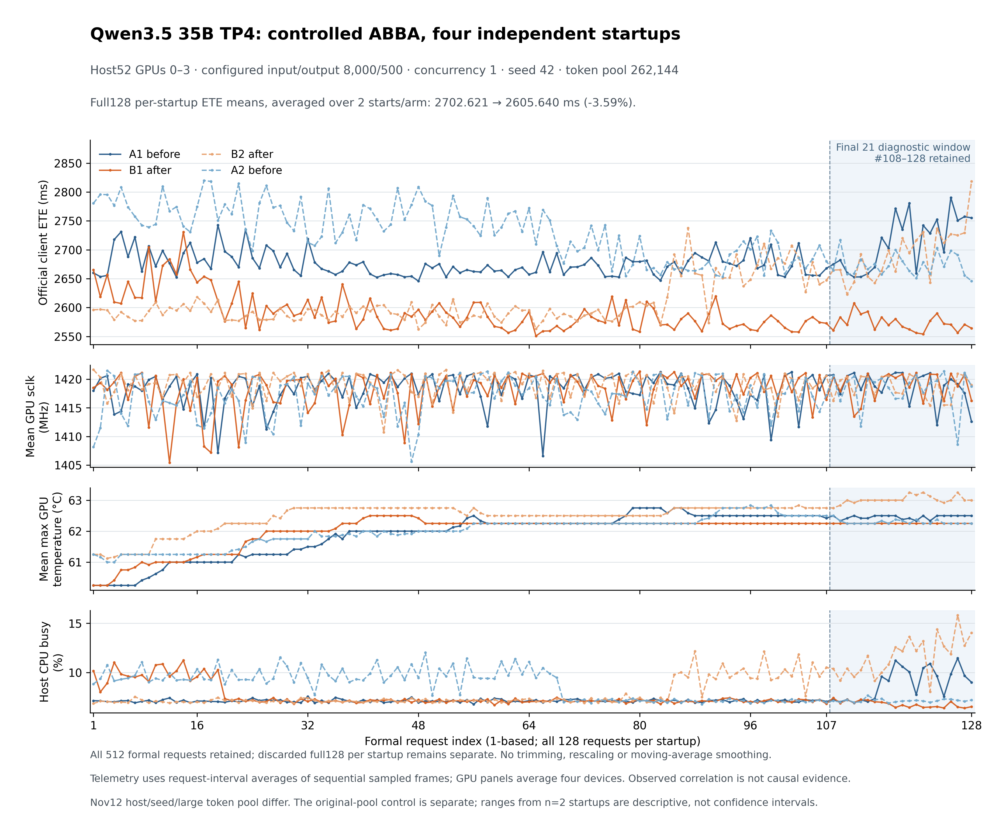
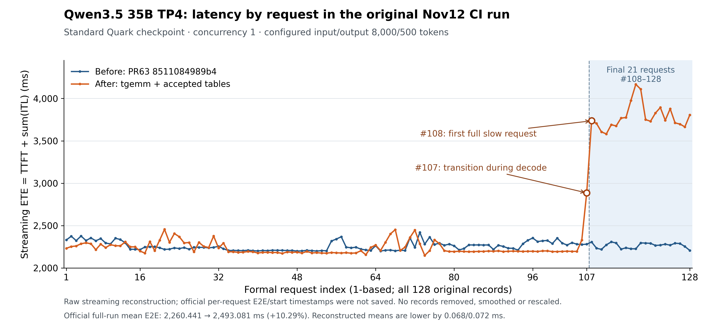

# PR63 / issue88 tgemm prototype evidence

This evidence describes the locally measured implementation on PR63 head `8511084989b4`. The source draft additionally integrates current `qwen4_v0.5.21` (`9ac4ebe`) and repairs packed fused scalar/FP16 tuple fallback. Prototype measurements are not final-head online CI results.

## Controlled concurrency-1 comparison (2026-11-16)

Quark Qwen3.5-35B-A3B-PTPC-FP8, TP4, four MI308X on a PTL machine, random configured 8,000/500 tokens, seed42, radix disabled, full decode graph, fixed token pool262144. Four independent startups ABBA, two per arm; each retained a complete discarded128 repetition before its complete128 formal repetition, each with10 warmups. All512 formal and512 discarded requests and8 quality smoke requests passed. Means below weight both independent startups equally.

| Metric | Before hipBLASLt | After prototype tgemm | Change |
|---|---:|---:|---:|
| ETE ms | 2702.621006 | 2605.640445 | -3.5884% |
| TTFT ms | 196.138443 | 189.617294 | -3.3248% |
| TPOT ms | 5.023011 | 4.841730 | -3.6090% |
| Output tok/s | 184.944843 | 191.822877 | +3.7190% |

Before startup ETE range2681.692–2723.550ms; after2590.476–2620.805ms. Two-start ranges are descriptive, not confidence intervals. Formal1361/1361 owner samples were complete; three terminal cleanup samples were incomplete. No selected-device overlap was detected.

An after-only, one-startup control using25,637,215 tokens (matching the original before CI capacity) also passed128 discarded+128 formal requests: ETE2620.342757ms, TTFT191.010712ms, TPOT4.868400892ms, output190.741793838tok/s. The last21 averaged2663.288813ms; zero requests exceeded3s. Its formal335/335 ownership samples were complete. It is separate from the main ABBA score.

## Original prototype CI observation (2026-11-12)

The six normal cases each ran128 performance requests and200 GSM8K questions on both sides:1536 performance requests and2400 scored examples, zero terminal errors, all recorded GSM8K reference×0.97 gates passed. Each original case had one startup per side. `data/six_model_ci.json` retains all cases and observed tradeoffs, including the35B/TP4 Base ETE regression of10.29% and output-throughput decline9.33%.

For35B/TP4, the original final21 requests slowed to3785.245ms from2264.673ms, while first107 went2259.529→2239.392ms. The plot uses raw TTFT+sum(ITL) reconstruction; official per-request latency was not saved for those original CI runs. All128 original records remain included in the reported mean. The persistent server-side slowdown began during request107, with concurrency1, queue0 and graph=True unchanged. Its historical trigger is unresolved; current repeated tests do not retrospectively prove an environmental or kernel cause.

## Caller validation and reproduction

The measured prototype passed81 actual LinearMethod caller cases and162 changed-input graph replays. BF16 M1 router graph8.107→7.333us, in_proj_b/a7.663→2.814us; Quark FP8 M1 remained CK. Three FP8 M8000 caller cases improved23–34%. Eager BF16 calls had additional Python/launch cost; caller event timings are not isolated full-model kernel trace evidence. A new paired TP1 full-model capture is now available in [profiling/tp1](profiling/tp1/); its operator workload remains separate from these ETE scores.

`data/tested-implementation.patch` reconstructs the measured prototype from8511084989b4. `configs/` contains the exact external AITER baseline/accepted CSVs used for these measurements; these are complete runtime snapshots; the source draft now also includes five validated overlay rows and a table-merge/reproduction kit. AITER library algorithms remain the existing dependency. In the measured35B shapes, the added tuning rows did not match and after-base/after-tuned dispatch choices agreed. `data/controlled_runs.json` retains per-startup unrounded metrics, source hashes and all official formal request timings. `MANIFEST.json` records artifact hashes. No raw sessions, credentials, model weights or private command environments are published.

## Final draft source boundary checks

Final commit `f315e8da2e3e9bed6e948fd5a835aeae165b5921`, base `9ac4ebe4a16d5b8a55473eec17cdeee8916a544f`:8 focused CPU regression methods and16 native AITER caller cases with32 changed-input CUDA Graph replays passed on Torch2.12/ROCm7.14/AITER514c166. These validate canonical BF16 ownership and packed scalar/per-token BF16/FP16 tuple boundaries; they are not whole-model performance results. All changed-file syntax, isort and Ruff checks and affected test registries passed. The full registry hook reports an unchanged base taxonomy error in `test/registered/kernels/test_pyhip_qsa.py`; it remains outside this source change. Exact final-head whole-model CI remains pending. The newly captured complete-model profiling pair is explicitly attributed to the frozen measured prototype in [profiling/tp1](profiling/tp1/).

## Complete tgemm scope (2026-11-16 update)

The source draft now has two commits (`f315e8d`, `05cd615`): complete FP8/BF16 routing, canonical dense weights and packed prefill copies, small-M CK decode, tuple/layout guards, five validated tuning deltas, sixteen tuning input shapes, numerical/Graph benchmark and native six-case CI entrypoints. Runtime code is unchanged by the second source-kit commit; ten additional standard-library regressions and complete-table merging checks passed.

- [Full performance/CI inventory, regressions and source boundaries](data/full-tgemm-inventory.md)
- [Nov9/10 raw experiments, all16 GEMMs, tuning-support patches and restore records](docs/pr63-tgemm-issue88/full-tgemm/)
- [Four native Perfetto screenshots, matched complete originals and hashes](profiling/tp1/)

Historical inventory statements about missing traces describe what existed at that earlier measurement stage; the new profiling has its own source attribution and manifest. All-six prototype CI must not be presented as final-head GPU CI.
